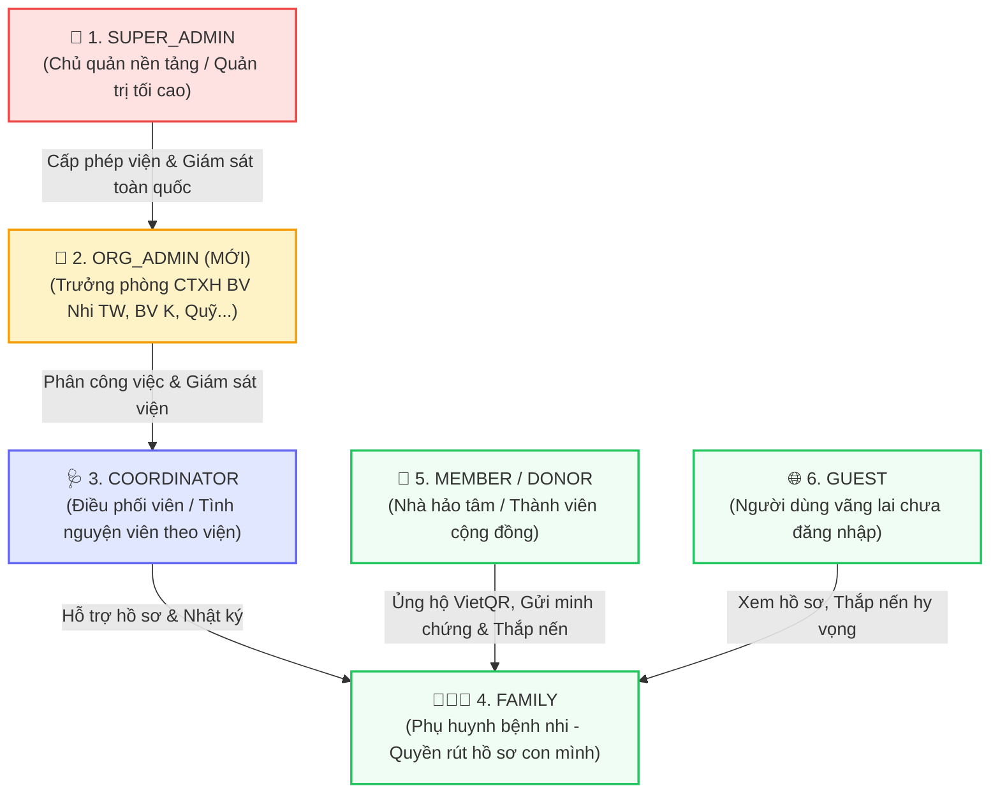
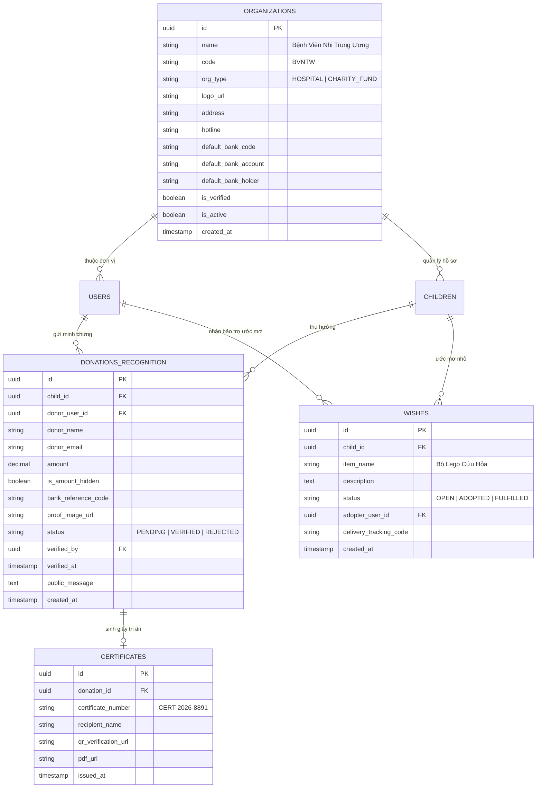
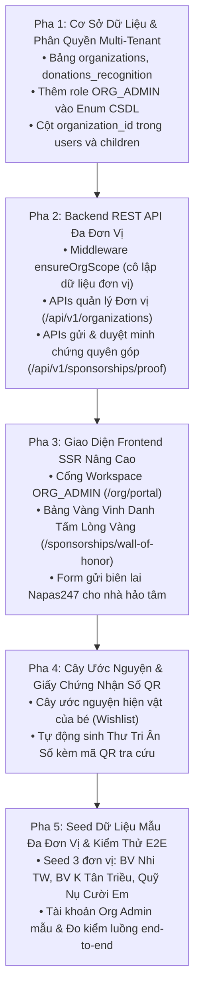

# Đề Xuất Nâng Cấp Hệ Thống: Không Gian Làm Việc Đa Đơn Vị (Multi-Tenant Workspace), Phân Quyền 6 Cấp & Danh Mục Tính Năng Đột Phá

> **Mã tài liệu:** `04_EXPANDED_FEATURES_AND_ROLES_PROPOSAL.md`  
> **Dự án:** Cổng Lưu Trữ, Tri Ân & Vinh Danh Các Chiến Binh Nhí (*Courageous Little Warriors Memorial & Tribute Hub*)  
> **Môn học:** BIT208V1 - Dự Án Công Nghệ Thông Tin  
> **Định hướng chiến lược:** Chuyển đổi từ mô hình Đơn đơn vị (Single-Tenant) thành **Nền Tảng Liên Viện Cấp Quốc Gia (National Federated Multi-Tenant Platform)** kết nối các Bệnh viện Nhi, Quỹ Thiện nguyện và Nhà hảo tâm.

---

## 📌 Mục Lục Nội Dung

1. [Bối Cảnh & Sự Cần Thiết Của Vai Trò Admin Đơn Vị (`ORG_ADMIN`)](#1-bối-cảnh--sự-cần-thiết-của-vai-trò-admin-đơn-vị-org_admin)
2. [Hệ Thống Phân Quyền 6 Cấp Chuẩn Hóa (6-Tier Hierarchical RBAC)](#2-hệ-thống-phân-quyền-6-cấp-chuẩn-hóa-6-tier-hierarchical-rbac)
3. [Bảng Ma Trận Phân Chia Chức Năng Theo Vai Trò (Role-Feature Matrix)](#3-bảng-ma-trận-phân-chia-chức-năng-theo-vai-trò-role-feature-matrix)
4. [Chi Tiết Các Tính Năng Đề Xuất Theo Từng Vai Trò](#4-chi-tiết-các-tính-năng-đề-xuất-theo-từng-vai-trò)
5. [Thiết Kế Cơ Sở Dữ Liệu Mở Rộng (Schema Evolution & ERD)](#5-thiết-kế-cơ-sở-dữ-liệu-mở-rộng-schema-evolution--erd)
6. [Lộ Trình Triển Khai Kỹ Thuật (Phased Implementation Roadmap)](#6-lộ-trình-triển-khai-kỹ-thuật-phased-implementation-roadmap)

---

## 1. Bối Cảnh & Sự Cần Thiết Của Vai Trò Admin Đơn Vị (`ORG_ADMIN`)

### 1.1. Khoảng trống quản lý hiện tại (The Management Gap)
Trong kiến trúc ban đầu của dự án, hệ thống mới chỉ có 2 vai trò quản trị/vận hành:
* **`ADMIN` (Quản trị viên tối cao):** Có toàn quyền can thiệp vào máy chủ kỹ thuật, xem toàn bộ dữ liệu, sửa đổi CSDL.
* **`COORDINATOR` (Điều phối viên hiện trường):** Tình nguyện viên hoặc bác sĩ nhập liệu (chỉ viết bài, tải ảnh tranh vẽ của bé).

### 1.2. Mâu thuẫn trong môi trường y tế & xã hội thực tế
Trong thực tế, các đơn vị tham gia nền tảng (Bệnh viện Nhi Trung Ương, Bệnh viện K Tân Triều, Bệnh viện Nhi Đồng 1, Bệnh viện Trung ương Huế, Quỹ Trò Nghèo Vùng Cao, CLB Nụ Cười Em...) là các **pháp nhân độc lập**:
* **Trưởng phòng Công tác Xã hội (CTXH) của Bệnh viện Nhi TW** không thể được cấp quyền `ADMIN` tối cao (vì họ không được phép xem hồ sơ nội bộ của BV K Tân Triều, cũng không được can thiệp vào cấu hình server hạ tầng).
* Nhưng họ **cũng không thể chỉ mang vai trò `COORDINATOR`** (vì họ là lãnh đạo cấp viện: cần quản lý danh sách các tình nguyện viên của viện mình, quản lý số tài khoản viện phí chính thức của bệnh viện, đối soát biến động số dư viện phí và duyệt cấp tài khoản đóng cho phụ huynh sau khi kiểm tra CCCD).

### 1.3. Kết luận kiến trúc
> Việc bổ sung vai trò **`ORG_ADMIN` (Admin Đơn vị / Bệnh viện / Quỹ)** là mắt xích bắt buộc để giải quyết trọn vẹn bài toán **Phân vùng dữ liệu đa tổ chức (Multi-Tenant Data Partitioning)**, đáp ứng các tiêu chuẩn bảo mật dữ liệu y tế và quy định pháp lý tại Việt Nam.

---

## 2. Hệ Thống Phân Quyền 6 Cấp Chuẩn Hóa (6-Tier Hierarchical RBAC)

### Bảng phân cấp quyền hạn chi tiết:

| Cấp | Vai trò (Role) | Đại diện thực tế | Phạm vi dữ liệu (Scope) | Thẩm quyền cốt lõi |
| :---: | :--- | :--- | :--- | :--- |
| **1** | **`SUPER_ADMIN`** | Ban điều hành Nền tảng Quốc gia | Toàn bộ hệ thống (Global) | Phê duyệt cấp phép Bệnh viện/Quỹ mới; Quản trị máy chủ; Giám sát toàn bộ Audit Trail; Khóa tài khoản vi phạm. |
| **2** | **`ORG_ADMIN`** *(Mới)* | Trưởng phòng CTXH Viện, Giám đốc Quỹ | Đơn vị mình phụ trách (Tenant) | Quản lý đội ngũ Coordinator của viện; Duyệt xuất bản hồ sơ bé; Cấu hình tài khoản ngân hàng viện phí; Đối soát & duyệt vinh danh biên lai quyên góp; Cấp tài khoản FAMILY. |
| **3** | **`COORDINATOR`** | Điều phối viên, Bác sĩ điều trị | Ca bệnh được giao trong viện | Soạn thảo câu chuyện bé; Tải tranh vẽ kỷ vật; Tiền kiểm duyệt lời chúc cộng đồng; Hỗ trợ gia đình cập nhật nhật ký. |
| **4** | **`FAMILY`** | Cha mẹ / Người giám hộ hợp pháp | Chỉ duy nhất con của mình | Cập nhật nhật ký điều trị; Xác nhận đã nhận viện phí; Thực thi **Quyền rút hồ sơ khẩn cấp (Emergency Unpublish)** tức thời theo Luật Trẻ em 2016. |
| **5** | **`MEMBER / DONOR`** | Nhà hảo tâm, Tình nguyện viên | Tài khoản cá nhân | Quét mã VietQR chuyển viện phí; Gửi ảnh biên lai đối soát vinh danh; Nhận tặng quà qua Wishlist; Tải Chứng nhận tri ân điện tử; Gửi Voice Note. |
| **6** | **`GUEST`** | Cộng đồng xã hội | Chỉ đọc (Read-only) | Tìm kiếm FTS tiếng Việt; Xem câu chuyện bé; Xem Bản Đồ Hy Vọng; Xem Bảng Vàng vinh danh; Thắp nến hy vọng; Quét mã VietQR chuyển khoản trực tiếp. |

---

## 3. Bảng Ma Trận Phân Chia Chức Năng Theo Vai Trò (Role-Feature Matrix)

> Ký hiệu:  
> ✅ = Chức năng hiện đã có trong mã nguồn (Đã hoàn thành ở Giai đoạn 1–4).  
> ✨ = Chức năng mới đề xuất nâng cấp.  
> ❌ = Không có quyền truy cập.

| STT | Tên chức năng / Phân hệ | 1. GUEST | 2. DONOR | 3. FAMILY | 4. COORD | 5. ORG_ADMIN | 6. SUPER_ADMIN |
| :---: | :--- | :---: | :---: | :---: | :---: | :---: | :---: |
| **I** | **TRA CỨU & TƯƠNG TÁC CÔNG KHAI** | | | | | | |
| 1 | Xem danh sách bé & Lọc đa chiều | ✅ | ✅ | ✅ | ✅ | ✅ | ✅ |
| 2 | Tìm kiếm toàn văn tiếng Việt FTS (`tsvector`) | ✅ | ✅ | ✅ | ✅ | ✅ | ✅ |
| 3 | Xem chi tiết hồ sơ & Tranh vẽ kỷ vật | ✅ | ✅ | ✅ | ✅ | ✅ | ✅ |
| 4 | Thắp nến hy vọng (Live Atomic Counter) | ✅ | ✅ | ✅ | ✅ | ✅ | ✅ |
| 5 | Gửi lời chúc tri ân (Pre-moderation) | ✅ | ✅ | ✅ | ✅ | ✅ | ✅ |
| 6 | Bản đồ hy vọng tương tác 63 tỉnh thành | ✨ | ✨ | ✨ | ✨ | ✨ | ✨ |
| 7 | Xem Bảng Vàng Vinh Danh Tấm Lòng Vàng | ✨ | ✨ | ✨ | ✨ | ✨ | ✨ |
| **II** | **BẢO TRỢ & VINH DANH NHÀ HẢO TÂM** | | | | | | |
| 8 | Quét mã VietQR Napas247 viện phí trực tiếp | ✅ | ✅ | - | - | - | - |
| 9 | Gửi ảnh minh chứng biên lai chuyển khoản | ❌ | ✨ | - | - | - | - |
| 10 | Tùy chọn vinh danh: Công khai vs Ẩn danh | ❌ | ✨ | - | - | - | - |
| 11 | Nhận Giấy Chứng Nhận Tri Ân Số (Mã QR tra cứu)| ❌ | ✨ | - | - | - | - |
| 12 | Nhận tặng quà theo Cây Ước Nguyện của bé | ❌ | ✨ | - | - | - | - |
| 13 | Thu âm lời chúc âm thanh (Voice Notes 30s) | ❌ | ✨ | - | - | - | - |
| 14 | Sổ tay thiện nguyện cá nhân (Lịch sử ủng hộ) | ❌ | ✨ | - | - | - | - |
| **III**| **CỔNG HỘ GIA ĐÌNH BỆNH NHI** | | | | | | |
| 15 | Xem hồ sơ con mình quản lý | ❌ | ❌ | ✅ | ❌ | ✅ *(Viện mình)*| ✅ *(Toàn quốc)*|
| 16 | Cập nhật nhật ký điều trị & ước mơ bé | ❌ | ❌ | ✅ | ✅ | ✅ | ✅ |
| 17 | **Rút hồ sơ khẩn cấp (Emergency Unpublish)**| ❌ | ❌ | ✅ *(Không cần duyệt)* | ❌ | ✅ *(Theo yêu cầu)* | ✅ |
| 18 | Xác nhận đã nhận được viện phí từ nhà hảo tâm| ❌ | ❌ | ✨ | ✨ | ✨ | ✅ |
| 19 | Sổ theo dõi tiến độ viện phí & sao kê (NĐ 93) | ❌ | ❌ | ✨ | ✨ | ✨ | ✅ |
| 20 | Gửi thư cảm ơn trực tiếp đến nhà hảo tâm | ❌ | ❌ | ✨ | ❌ | ❌ | ❌ |
| **IV** | **VẬN HÀNH & ĐIỀU PHỐI VIÊN** | | | | | | |
| 21 | Soạn thảo hồ sơ bệnh nhi mới (Bản nháp) | ❌ | ❌ | ❌ | ✅ | ✅ | ✅ |
| 22 | Tải lên tranh vẽ & kỷ vật của bé | ❌ | ❌ | ❌ | ✅ | ✅ | ✅ |
| 23 | Tiền kiểm duyệt Lời chúc tri ân | ❌ | ❌ | ❌ | ✅ | ✅ | ✅ |
| 24 | Hỗ trợ phụ huynh đối soát chứng từ viện phí | ❌ | ❌ | ❌ | ✨ | ✨ | ❌ |
| **V**  | **QUẢN TRỊ ĐƠN VỊ / BỆNH VIỆN (MỚI)** | | | | | | |
| 25 | Bảng điều khiển Workspace riêng của Đơn vị | ❌ | ❌ | ❌ | ❌ | ✨ | ✅ |
| 26 | Quản lý danh sách Điều phối viên thuộc viện | ❌ | ❌ | ❌ | ❌ | ✨ | ❌ |
| 27 | Cấu hình thông tin & STK Viện phí của Đơn vị | ❌ | ❌ | ❌ | ❌ | ✨ | ✅ |
| 28 | Duyệt & Xuất bản hồ sơ bệnh nhi ra công chúng| ❌ | ❌ | ❌ | ❌ | ✨ | ✅ |
| 29 | Cấp tài khoản đóng `FAMILY` sau đối soát CCCD| ❌ | ❌ | ❌ | ❌ | ✨ | ✅ |
| 30 | Phê duyệt biên lai ủng hộ để đưa lên Bảng Vàng| ❌ | ❌ | ❌ | ❌ | ✨ | ✅ |
| 31 | Xuất báo cáo tài chính viện phí đơn vị (Excel)| ❌ | ❌ | ❌ | ❌ | ✨ | ✅ |
| **VI** | **QUẢN TRỊ TỐI CAO TOÀN SÀN** | | | | | | |
| 32 | Tiếp nhận & Cấp phép Đơn vị / Bệnh viện mới | ❌ | ❌ | ❌ | ❌ | ❌ | ✨ |
| 33 | Khóa / Tạm dừng hoạt động đơn vị vi phạm | ❌ | ❌ | ❌ | ❌ | ❌ | ✨ |
| 34 | Bảng thống kê vĩ mô bệnh nhi & dòng tiền toàn quốc| ❌ | ❌ | ❌ | ❌ | ❌ | ✨ |
| 35 | Giám sát toàn bộ Nhật ký kiểm toán (Audit Logs) | ❌ | ❌ | ❌ | ❌ | ❌ | ✅ |
| 36 | Cấu hình máy chủ kỹ thuật & Backup CSDL | ❌ | ❌ | ❌ | ❌ | ❌ | ✅ |

---

## 4. Chi Tiết Các Tính Năng Đề Xuất Theo Từng Vai Trò

### 4.1. Dành cho `ORG_ADMIN` (Admin Đơn vị - Trọng tâm nâng cấp số 1)
1. **Workspace Đơn Vị Độc Lập:**
   * Giao diện quản trị riêng biệt tại đường dẫn `/org/portal`.
   * Hiển thị logo, tên bệnh viện, số lượng ca bệnh đang điều trị, tổng số ngọn nến đã nhận của toàn viện.
2. **Quản Lý Đội Ngũ Điều Phối Viên (Coordinator Management):**
   * Phân quyền cho bác sĩ hoặc tình nguyện viên thuộc viện mình.
   * Giao ca bệnh cụ thể cho từng điều phối viên phụ trách theo dõi.
3. **Cấu Hình Tài Khoản Viện Phí Đơn Vị:**
   * Cập nhật số tài khoản ngân hàng chính thức của bệnh viện (ví dụ: BIDV Viện Nhi TW, Vietcombank BV K).
   * Mã bệnh nhân viện phí tự động ánh xạ vào mã VietQR Napas247.
4. **Phê Duyệt Minh Chứng Quyên Góp (Donation Proof Approval):**
   * Đối soát biến động số dư tài khoản viện phí ➔ Bấm nút **"Duyệt Vinh Danh"** để đưa tên nhà hảo tâm lên Bảng Vàng và hệ thống tự động sinh Giấy Chứng Nhận Số.
5. **Cấp Tài Khoản Gia Đình (Admin-Provisioned Family Account):**
   * Tiếp nhận hồ sơ bản cứng hoặc scan CCCD + Giấy khai sinh của cha mẹ ➔ Cấp tài khoản bảo mật cho phụ huynh để họ có quyền kiểm soát hồ sơ con mình theo Luật Trẻ em 2016.

### 4.2. Dành cho `MEMBER / DONOR` (Nhà hảo tâm - Trọng tâm nâng cấp số 2)
1. **Gửi Minh Chứng Quyên Góp Lên Bảng Vàng:**
   * Sau khi quét mã VietQR chuyển viện phí, nhà hảo tâm có thể vào form gửi minh chứng: Tải ảnh chụp màn hình chuyển khoản Napas247, nhập mã giao dịch, số tiền (tùy chọn ẩn hoặc hiện).
   * Tùy chọn: *Vinh danh tên tôi* hoặc *Vinh danh dưới danh nghĩa Một Nhà Hảo Tâm Ẩn Danh*.
2. **Bảng Vàng Tri Ân Tấm Lòng Vàng (Wall of Benefactors):**
   * Giao diện trang trọng, hiển thị danh sách các tấm lòng vàng đã đồng hành cùng các con.
   * Phân hạng biểu trưng ấm áp: *Trái Tim Đồng, Trái Tim Bạc, Trái Tim Vàng, Thiên Thần Hộ Mệnh*.
3. **Giấy Chứng Nhận Tri Ân Điện Tử (Digital Certificate of Appreciation):**
   * Tự động sinh file bằng khen số đẹp mắt mang tên nhà hảo tâm, có đóng mộc số của đơn vị/bệnh viện.
   * Tích hợp **Mã QR Code tra cứu tính minh bạch**: Bất kỳ ai quét mã QR trên bằng khen đều dẫn tới trang xác minh giao dịch chính thức của viện, ngăn chặn 100% tình trạng làm giả giấy khen từ thiện.
4. **Cây Ước Nguyện Của Bé (Warrior's Wishlist Registry):**
   * Danh mục các ước mơ cụ thể của bé (1 hộp bút màu 36 màu, 1 con gấu bông, 1 bộ xếp hình Lego cứu hỏa).
   * Nhà hảo tâm bấm "Nhận thực hiện ước mơ" ➔ Nhận mã bưu phẩm và địa chỉ phòng Công tác Xã hội bệnh viện để gửi quà tận tay bé.
5. **Bức Thư Âm Thanh (Audio Voice Messages):**
   * Bấm micro thu âm lời chúc yêu thương 30-60 giây gửi tặng con trong phòng cách ly vô trùng.

### 4.3. Dành cho `FAMILY` (Phụ huynh bệnh nhi)
1. **Sổ Viện Phí & Sao Kê Minh Bạch (Transparent Medical Tracker):**
   * Phụ huynh cập nhật các đợt tạm ứng viện phí (Đợt 1 phẫu thuật, Đợt 2 hóa trị...).
   * Hiển thị thanh tiến độ: *Kinh phí đã thanh toán / Kinh phí còn thiếu*.
2. **Xác Nhận Nhanh Tiền Viện Phí Đã Nhận:**
   * Khi nhà hảo tâm chuyển khoản trực tiếp vào tài khoản gia đình bé, phụ huynh có nút bấm "Xác nhận đã nhận được viện phí" trên Cổng Gia Đình để tự động vinh danh nhà hảo tâm.
3. **Nhật Ký Nhanh Di Động (Micro-Journaling):**
   * Giao diện mobile thân thiện: Đăng 1 dòng tin vui kèm 1 bức ảnh chụp nụ cười của con ("Hôm nay con đã ăn được hết 1 bát cháo nhỏ!").

### 4.4. Dành cho `SUPER_ADMIN` (Quản trị viên tối cao)
1. **Quản Lý Danh Mục Bệnh Viện & Quỹ (Multi-Tenant Hub Management):**
   * Cấp phép kích hoạt Workspace cho đơn vị mới.
   * Tạm dừng hoặc thu hồi giấy phép nếu đơn vị vi phạm quy định minh bạch.
2. **Bản Đồ Hy Vọng Việt Nam (Interactive Hope Map):**
   * Bản đồ tương tác 63 tỉnh thành: Hiển thị mạng lưới bệnh viện nhi đồng hành và tổng số ngọn nến đã thắp sáng trên khắp cả nước.
3. **Bảng Thống Kê Vĩ Mô Toàn Quốc:**
   * Biểu đồ phân tích tỷ lệ bệnh nhi theo nhóm bệnh lý (Ung thư máu, U não, U thận...) và mức độ phân bổ viện phí hỗ trợ.

---

## 5. Thiết Kế Cơ Sở Dữ Liệu Mở Rộng (Schema Evolution & ERD)

---

## 6. Lộ Trình Triển Khai Kỹ Thuật (Phased Implementation Roadmap)

---

## 7. Kết Luận & Ý Nghĩa Đối Với Đồ Án BIT208V1

Việc nâng cấp hệ thống theo bản đặc tả này mang lại 3 giá trị học thuật và thực tiễn vượt trội:
1. **Tính Thực Tiễn (High Practical Feasibility):** Mô phỏng chuẩn xác 100% cách thức vận hành liên viện giữa Bệnh viện Nhi TW, Bệnh viện K, Quỹ thiện nguyện và các gia đình bệnh nhi ngoài đời thực.
2. **Tính Pháp Lý Vững Chắc:** Tuân thủ đồng thời **Luật Trẻ em 2016** (Quyền rút hồ sơ khẩn cấp của cha mẹ), **Nghị định 13/2023/NĐ-CP** (Bảo vệ dữ liệu cá nhân) và **Nghị định 93/2021/NĐ-CP** (Minh bạch dòng tiền quyên góp, chống trục lợi danh xưng từ thiện).
3. **Kiến Trúc Chuẩn Doanh Nghiệp (Enterprise Architecture):** Thể hiện rõ nét năng lực thiết kế phần mềm với mô hình **Multi-Tenant Row-Level Security**, **6-Tier Hierarchical RBAC**, và **Decoupled RESTful API**.
