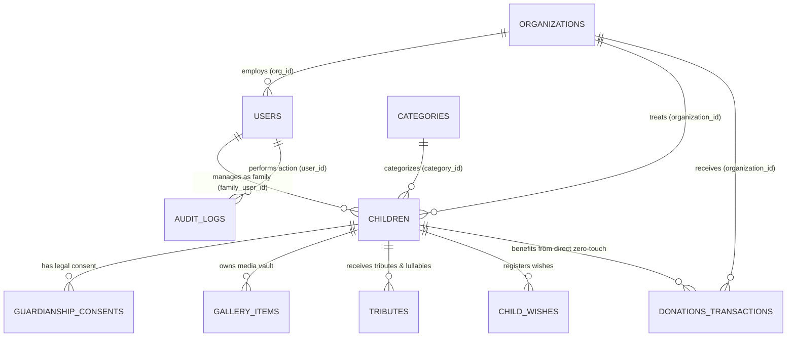

# 🗄️ Từ Điển Dữ Liệu & Thiết Kế CSDL Chuẩn Hóa 3NF (Database Schema Dictionary)
### Dự Án: Cổng Ký Ức, Tri Ân & Vinh Danh Các Chiến Binh Nhí (Courageous Little Warriors Hub)
> **Mã môn học:** BIT208V1 - Đồ Án Chuyên Ngành Công Nghệ Thông Tin  
> **Hệ quản trị CSDL:** PostgreSQL 16 Alpine  
> **Công cụ điều phối & di trú:** Knex.js Migration & Seed Engine  
> **Cập nhật:** 19/10/2026 (Phiên bản v2.0 - Chuẩn hóa 3NF, Phân rã danh tính & Media Vault)

---

## 📌 Mục Lục
1. [Sơ Đồ Thực Thể - Quan Hệ (Mermaid Entity-Relationship Diagram)](#1-sơ-đồ-thực-thể---quan-hệ-mermaid-entity-relationship-diagram)
2. [Chi Tiết Từ Điển Dữ Liệu 10 Bảng](#2-chi-tiết-từ-điển-dữ-liệu-10-bảng)
   - [2.1. Bảng `users` (Người dùng & Phân rã danh tính đa thành tố)](#21-bảng-users)
   - [2.2. Bảng `organizations` (Bệnh viện & Quỹ bảo trợ)](#22-bảng-organizations)
   - [2.3. Bảng `categories` (Nhóm bệnh lý hiểm nghèo)](#23-bảng-categories)
   - [2.4. Bảng `children` (Hồ sơ bệnh nhi & Chiến binh nhí)](#24-bảng-children)
   - [2.5. Bảng `guardianship_consents` (Minh chứng pháp lý giám hộ)](#25-bảng-guardianship_consents)
   - [2.6. Bảng `child_wishes` (Cây điều ước trực tuyến)](#26-bảng-child_wishes)
   - [2.7. Bảng `gallery_items` (Kho kỷ niệm đa phương tiện)](#27-bảng-gallery_items)
   - [2.8. Bảng `tributes` (Thắp nến, lời chúc & Tin nhắn thoại)](#28-bảng-tributes)
   - [2.9. Bảng `donations_transactions` (Đối soát viện phí & Chứng nhận số)](#29-bảng-donations_transactions)
   - [2.10. Bảng `audit_logs` (Nhật ký kiểm toán bảo mật)](#210-bảng-audit_logs)
3. [Chiến Lược Đánh Chỉ Mục & Full-Text Search (Indexing & FTS)](#3-chiến-lược-đánh-chỉ-mục--full-text-search-indexing--fts)

---

## 1. Sơ Đồ Thực Thể - Quan Hệ (Mermaid Entity-Relationship Diagram)



---

## 2. Chi Tiết Từ Điển Dữ Liệu 10 Bảng

### 2.1. Bảng `users`
Bảng quản lý tài khoản, phân quyền RBAC và lưu trữ cấu trúc danh tính đã phân rã chuẩn hóa:

| Tên Cột | Kiểu Dữ Liệu | Ràng Buộc / Mặc Định | Ý Nghĩa Kỹ Thuật |
| :--- | :--- | :--- | :--- |
| `id` | `UUID` | `PRIMARY KEY`, Default `gen_random_uuid()` | Định danh người dùng duy nhất. |
| `email` | `VARCHAR(255)` | `UNIQUE`, `NOT NULL` | Email đăng nhập hệ thống (viết thường). |
| `password_hash` | `VARCHAR(255)` | `NOT NULL` | Mật khẩu mã hóa Bcrypt (cost factor = 10). |
| `full_name` | `VARCHAR(255)` | `NOT NULL` | Họ tên đầy đủ (đồng bộ tự động để tương thích). |
| `last_name` | `VARCHAR(50)` | `NULLABLE` | Họ của người dùng (VD: *Nguyễn, Lê, Trần*). |
| `middle_name` | `VARCHAR(50)` | `NULLABLE` | Tên đệm (VD: *Văn, Thị, Minh*). |
| `first_name` | `VARCHAR(50)` | `NULLABLE` | Tên gọi chính (VD: *An, Chi, Mai, Trị*). |
| `gender` | `VARCHAR(20)` | Default `'UNSPECIFIED'`, CHECK in `('MALE', 'FEMALE', 'OTHER', 'UNSPECIFIED')` | Giới tính dùng để sinh tiền tố xưng hô Ông/Bà (Mr/Mrs). |
| `title_prefix` | `VARCHAR(50)` | `NULLABLE` | Học hàm/học vị (VD: *BS., ThS.BS., TS., KTS.*). |
| `family_relation`| `VARCHAR(50)` | `NULLABLE` | Quan hệ với bé của vai trò `FAMILY` (VD: *Bố, Mẹ, Ông*). |
| `job_title` | `VARCHAR(100)`| `NULLABLE` | Chức danh chuyên môn (VD: *Trưởng Khoa Ung Bướu*). |
| `department` | `VARCHAR(150)`| `NULLABLE` | Khoa phòng y tế (VD: *Khoa Huyết học Ung bướu*). |
| `display_mode` | `VARCHAR(30)` | Default `'FULL_NAME'`, CHECK in `('FULL_NAME', 'FIRST_ONLY', 'LAST_FIRST', 'INITIALS', 'ANONYMOUS')` | Chế độ hiển thị tên ưu tiên. |
| `include_prefix_in_display` | `BOOLEAN` | Default `TRUE` | Có gắn tiền tố xưng hô (Ông/Bà) khi hiển thị hay không. |
| `include_title_in_display` | `BOOLEAN` | Default `TRUE` | Có hiển thị học hàm/chức vụ hay không. |
| `include_relation_in_display`| `BOOLEAN` | Default `TRUE` | Có hiển thị quan hệ với bé đối với phụ huynh hay không. |
| `phone_number` | `VARCHAR(20)` | `NULLABLE` | Số điện thoại liên hệ. |
| `role` | `VARCHAR(20)` | `NOT NULL`, CHECK in `('MEMBER', 'COORDINATOR', 'ORG_ADMIN', 'FAMILY', 'ADMIN', 'SUPER_ADMIN')` | Vai trò hệ thống trong mô hình RBAC. |
| `org_id` | `UUID` | `NULLABLE`, FK $\rightarrow$ `organizations.id` `ON DELETE SET NULL` | Cơ sở y tế trực thuộc nếu là nhân sự bệnh viện. |
| `is_active` | `BOOLEAN` | Default `TRUE` | Trạng thái hoạt động (Admin có thể tạm khóa). |
| `created_at` | `TIMESTAMPTZ` | Default `CURRENT_TIMESTAMP` | Thời điểm khởi tạo tài khoản. |

---

### 2.2. Bảng `organizations`
Quản lý các cơ sở y tế tuyến đầu và quỹ bảo trợ trong mô hình đa cơ sở y tế:

| Tên Cột | Kiểu Dữ Liệu | Ràng Buộc / Mặc Định | Ý Nghĩa Kỹ Thuật |
| :--- | :--- | :--- | :--- |
| `id` | `UUID` | `PRIMARY KEY`, Default `gen_random_uuid()` | Định danh cơ sở y tế. |
| `name` | `VARCHAR(255)` | `NOT NULL` | Tên chính thức của Bệnh viện / Quỹ. |
| `code` | `VARCHAR(50)` | `UNIQUE`, `NOT NULL` | Mã viết tắt (VD: `BV_NHI_TW`, `BV_K_TAN_TRIEU`). |
| `logo_url` | `VARCHAR(500)` | `NULLABLE` | Đường dẫn ảnh logo viện. |
| `bank_name` | `VARCHAR(100)` | `NOT NULL` | Tên ngân hàng nhận viện phí (Vietcombank, BIDV...). |
| `bank_code` | `VARCHAR(20)` | `NOT NULL` | Mã chuẩn Napas247 (VCB, BIDV, TCB, MB...). |
| `bank_account_number` | `VARCHAR(50)` | `NOT NULL` | Số tài khoản viện phí chính thức của bệnh viện. |
| `bank_account_name` | `VARCHAR(150)` | `NOT NULL` | Tên chủ tài khoản in hoa không dấu. |
| `contact_person`| `VARCHAR(150)` | `NULLABLE` | Trưởng phòng hoặc cán bộ phụ trách CTXH. |
| `phone` | `VARCHAR(50)` | `NULLABLE` | Đường dây nóng CTXH tiếp nhận quà và hỗ trợ. |
| `email` | `VARCHAR(100)` | `NULLABLE` | Email tiếp nhận của bệnh viện. |
| `address` | `VARCHAR(255)` | `NULLABLE` | Địa chỉ trụ sở tiếp nhận quà. |
| `province` | `VARCHAR(100)` | `NULLABLE` | Tỉnh/thành phố phục vụ lọc vùng miền. |
| `lat` / `lng` | `DECIMAL(10,8)`| `NULLABLE` | Tọa độ GPS hiển thị trên Bản Đồ Hy Vọng. |
| `is_active` | `BOOLEAN` | Default `TRUE` | Trạng thái tiếp nhận hỗ trợ của cơ sở. |

---

### 2.3. Bảng `categories`
Nhóm danh mục phân loại bệnh lý của các bệnh nhi:

| Tên Cột | Kiểu Dữ Liệu | Ràng Buộc / Mặc Định | Ý Nghĩa Kỹ Thuật |
| :--- | :--- | :--- | :--- |
| `id` | `SERIAL` | `PRIMARY KEY` | Khóa chính tự tăng. |
| `name` | `VARCHAR(100)` | `NOT NULL` | Tên bệnh lý (VD: *Bạch cầu cấp, U Wilms, U não*). |
| `slug` | `VARCHAR(100)` | `UNIQUE`, `NOT NULL` | Slug thân thiện URL (*bach-cau-cap*). |
| `description` | `TEXT` | `NULLABLE` | Mô tả sơ lược y khoa về bệnh lý. |

---

### 2.4. Bảng `children`
Bảng trung tâm lưu trữ hồ sơ bệnh án, trạng thái điều trị và thông tin bảo trợ của bé:

| Tên Cột | Kiểu Dữ Liệu | Ràng Buộc / Mặc Định | Ý Nghĩa Kỹ Thuật |
| :--- | :--- | :--- | :--- |
| `id` | `UUID` | `PRIMARY KEY`, Default `gen_random_uuid()` | Định danh duy nhất của hồ sơ bé. |
| `full_name` | `VARCHAR(255)` | `NOT NULL` | Họ và tên khai sinh của bé. |
| `nickname` | `VARCHAR(100)` | `NULLABLE` | Biệt danh thân mật ở nhà (VD: *Bé Bơ, Bé Bống*). |
| `slug` | `VARCHAR(255)` | `UNIQUE`, `NOT NULL` | Đường dẫn URL cố định (VD: *nguyen-minh-an-bo*). |
| `dob` | `DATE` | `NULLABLE` | Ngày tháng năm sinh. |
| `hometown` | `VARCHAR(100)` | `NOT NULL` | Quê quán hoặc nơi cư trú của gia đình. |
| `status` | `VARCHAR(20)` | `NOT NULL`, CHECK in `('FIGHTER', 'URGENT', 'RECOVERED', 'ANGEL')` | Trạng thái điều trị y tế của bé. |
| `category_id` | `INTEGER` | `NOT NULL`, FK $\rightarrow$ `categories.id` | Nhóm danh mục bệnh lý. |
| `organization_id`| `UUID` | `NULLABLE`, FK $\rightarrow$ `organizations.id` | Cơ sở y tế bé đang điều trị nội trú. |
| `family_user_id` | `UUID` | `NULLABLE`, FK $\rightarrow$ `users.id` | Tài khoản phụ huynh/người giám hộ sở hữu hồ sơ. |
| `hospital_patient_code` | `VARCHAR(50)` | `NULLABLE` | Mã hồ sơ bệnh án nội trú tại bệnh viện. |
| `dream_summary` | `VARCHAR(500)` | `NULLABLE` | Tóm tắt ước mơ của bé (trở thành họa sĩ, cảnh sát...). |
| `story_html` | `TEXT` | `NOT NULL` | Nhật ký điều trị chi tiết (được làm sạch HTML). |
| `avatar_url` | `VARCHAR(500)` | `NULLABLE` | Ảnh đại diện khuôn mặt tươi vui của bé. |
| `candle_count` | `INTEGER` | Default `0` | Số ngọn nến hy vọng cộng đồng đã thắp tặng. |
| `bank_verified` | `BOOLEAN` | Default `FALSE` | Đã thẩm định tài khoản ngân hàng nhận viện phí. |
| `is_published` | `BOOLEAN` | Default `TRUE` | Trạng thái hiển thị công khai (ẩn ngay khi rút khẩn cấp). |
| `deleted_at` | `TIMESTAMPTZ` | `NULLABLE` | Thời điểm rút hồ sơ (Soft-delete / Right to be forgotten). |
| `search_vector` | `tsvector` | Tự động sinh qua Trigger | Vector chỉ mục tìm kiếm tiếng Việt toàn văn đa trọng số. |

---

### 2.5. Bảng `guardianship_consents`
Minh chứng pháp lý về quyền giám hộ theo Luật Trẻ em 2016:

| Tên Cột | Kiểu Dữ Liệu | Ràng Buộc / Mặc Định | Ý Nghĩa Kỹ Thuật |
| :--- | :--- | :--- | :--- |
| `id` | `UUID` | `PRIMARY KEY` | Khóa chính minh chứng. |
| `child_id` | `UUID` | `NOT NULL`, FK $\rightarrow$ `children.id` `ON DELETE CASCADE` | Bé được giám hộ. |
| `guardian_name` | `VARCHAR(255)`| `NOT NULL` | Họ tên cha mẹ hoặc người giám hộ hợp pháp. |
| `id_card_number`| `VARCHAR(20)` | `NOT NULL` | Số thẻ CCCD / Định danh cá nhân của người bảo trợ. |
| `consent_document_url` | `VARCHAR(500)` | `NOT NULL` | Ảnh chụp giấy khai sinh, giấy ủy quyền giám hộ. |
| `verified_by_admin` | `BOOLEAN` | Default `FALSE` | Trạng thái thẩm định giấy tờ của Ban quản trị. |

---

### 2.6. Bảng `child_wishes`
Cây Điều Ước trực tuyến lưu giữ các mong ước hồn nhiên của bệnh nhi:

| Tên Cột | Kiểu Dữ Liệu | Ràng Buộc / Mặc Định | Ý Nghĩa Kỹ Thuật |
| :--- | :--- | :--- | :--- |
| `id` | `UUID` | `PRIMARY KEY` | Khóa chính điều ước. |
| `child_id` | `UUID` | `NOT NULL`, FK $\rightarrow$ `children.id` `ON DELETE CASCADE` | Bé có điều ước. |
| `title` | `VARCHAR(255)` | `NOT NULL` | Tên món quà ước mơ (hộp màu, gấu bông, xe đồ chơi). |
| `description` | `TEXT` | `NULLABLE` | Tâm sự, mong muốn hồn nhiên của con. |
| `category` | `VARCHAR(50)` | `NOT NULL`, CHECK in `('TOY', 'BOOK', 'CLOTHES', 'EXPERIENCE', 'OTHER')` | Phân loại quà tặng. |
| `estimated_cost`| `DECIMAL(12,2)`| `NULLABLE` | Chi phí ước tính (VNĐ). |
| `status` | `VARCHAR(20)` | Default `'PENDING'`, CHECK in `('PENDING', 'PROMISED', 'FULFILLED')` | Trạng thái trao tặng điều ước. |
| `sponsor_name` | `VARCHAR(150)` | `NULLABLE` | Tên nhà hảo tâm đăng ký nhận trao tặng. |
| `sponsor_phone`| `VARCHAR(50)` | `NULLABLE` | Số điện thoại liên hệ trao quà. |

---

### 2.7. Bảng `gallery_items`
Kho Kỷ Niệm Của Con lưu trữ hình ảnh, video và bản vẽ đa phương tiện:

| Tên Cột | Kiểu Dữ Liệu | Ràng Buộc / Mặc Định | Ý Nghĩa Kỹ Thuật |
| :--- | :--- | :--- | :--- |
| `id` | `UUID` | `PRIMARY KEY` | Khóa chính kỷ vật. |
| `child_id` | `UUID` | `NOT NULL`, FK $\rightarrow$ `children.id` `ON DELETE CASCADE` | Bé sở hữu kỷ vật. |
| `media_url` | `VARCHAR(500)` | `NOT NULL` | URL ảnh, URL iframe YouTube embed, hoặc URL video MP4. |
| `media_type` | `VARCHAR(20)` | `NOT NULL`, CHECK in `('IMAGE', 'DRAWING', 'VIDEO', 'AUDIO', 'DOCUMENT')` | Định dạng phương tiện. |
| `caption` | `VARCHAR(255)` | `NULLABLE` | Tiêu đề hoặc lời tựa kỷ niệm (VD: *Nụ cười ngày sinh nhật*). |
| `media_source` | `VARCHAR(20)` | Default `'UPLOAD'`, CHECK in `('UPLOAD', 'EXTERNAL_URL')` | Nguồn dữ liệu (Tải lên hay Nhúng ngoài). |
| `duration_seconds`| `INTEGER` | `NULLABLE` | Thời lượng video/audio tính bằng giây. |
| `thumbnail_url` | `VARCHAR(500)`| `NULLABLE` | Ảnh thumbnail video (tự động lấy từ YouTube HQ). |
| `is_featured` | `BOOLEAN` | Default `FALSE` | Đánh dấu khoảnh khắc nổi bật trên trang chủ. |

---

### 2.8. Bảng `tributes`
Bức Tường Lời Chúc và Tin nhắn thoại thu âm Web Audio gửi gắm yêu thương:

| Tên Cột | Kiểu Dữ Liệu | Ràng Buộc / Mặc Định | Ý Nghĩa Kỹ Thuật |
| :--- | :--- | :--- | :--- |
| `id` | `UUID` | `PRIMARY KEY` | Khóa chính lời chúc. |
| `child_id` | `UUID` | `NOT NULL`, FK $\rightarrow$ `children.id` `ON DELETE CASCADE` | Bé nhận lời chúc. |
| `sender_name` | `VARCHAR(100)` | `NOT NULL` | Họ tên người gửi hoặc phụ huynh. |
| `sender_email`| `VARCHAR(255)` | `NULLABLE` | Email người gửi (bảo mật không công khai). |
| `content` | `TEXT` | `NOT NULL` | Lời chúc bằng văn bản (làm sạch XSS). |
| `audio_url` | `VARCHAR(500)` | `NULLABLE` | Đường dẫn file ghi âm giọng nói/lời ru `.webm`. |
| `duration_seconds`| `INTEGER` | `NULLABLE` | Độ dài bản thu âm tính bằng giây. |
| `status` | `VARCHAR(20)` | Default `'PENDING'`, CHECK in `('PENDING', 'APPROVED', 'REJECTED')` | Trạng thái tiền kiểm theo Nghị định 147/2024. |

---

### 2.9. Bảng `donations_transactions`
Đối soát tài chính dòng tiền Zero-touch và Cấp Chứng Nhận Số:

| Tên Cột | Kiểu Dữ Liệu | Ràng Buộc / Mặc Định | Ý Nghĩa Kỹ Thuật |
| :--- | :--- | :--- | :--- |
| `id` | `UUID` | `PRIMARY KEY` | Khóa chính giao dịch. |
| `transaction_code` | `VARCHAR(50)` | `UNIQUE`, `NOT NULL` | Mã giao dịch hệ thống (VD: `TX-1729...`). |
| `child_id` | `UUID` | `NOT NULL`, FK $\rightarrow$ `children.id` | Bé nhận hỗ trợ viện phí. |
| `organization_id` | `UUID` | `NOT NULL`, FK $\rightarrow$ `organizations.id` | Cơ sở y tế tiếp nhận tiền viện phí. |
| `donor_name` | `VARCHAR(100)` | `NOT NULL` | Tên nhà hảo tâm vinh danh. |
| `amount` | `DECIMAL(12,2)`| `NOT NULL`, CHECK `amount >= 10000` | Số tiền ủng hộ (VNĐ). |
| `proof_image_url` | `VARCHAR(500)` | `NULLABLE` | Ảnh chụp biên lai ngân hàng thực tế. |
| `status` | `VARCHAR(20)` | Default `'PENDING'`, CHECK in `('PENDING', 'VERIFIED', 'REJECTED')` | Trạng thái đối soát của Bệnh viện/Gia đình. |
| `is_anonymous` | `BOOLEAN` | Default `FALSE` | Tùy chọn ẩn danh trên Bức Tường Vinh Danh. |
| `certificate_code` | `VARCHAR(50)` | `UNIQUE`, `NULLABLE` | Số hiệu Chứng Nhận Số (VD: `CLW-2026-A1B2C3`). |
| `certificate_qr_token` | `VARCHAR(100)` | `UNIQUE`, `NULLABLE` | Token duy nhất tra cứu chứng nhận qua mã QR. |
| `certificate_signature`| `VARCHAR(255)` | `NULLABLE` | Chữ ký số mật mã chống làm giả HMAC-SHA256. |

---

### 2.10. Bảng `audit_logs`
Lưu trữ nhật ký kiểm toán bảo mật bất biến phục vụ truy vết:

| Tên Cột | Kiểu Dữ Liệu | Ràng Buộc / Mặc Định | Ý Nghĩa Kỹ Thuật |
| :--- | :--- | :--- | :--- |
| `id` | `UUID` | `PRIMARY KEY` | Khóa chính bản ghi kiểm toán. |
| `user_id` | `UUID` | `NULLABLE`, FK $\rightarrow$ `users.id` `ON DELETE SET NULL` | Người dùng thực hiện thao tác. |
| `action` | `VARCHAR(50)` | `NOT NULL` | Mã hành động (VD: `EMERGENCY_UNPUBLISH_CHILD`, `PROVISION_USER`). |
| `resource_type` | `VARCHAR(50)` | `NOT NULL` | Đối tượng tác động (`USERS`, `CHILDREN`, `DONATIONS`). |
| `resource_id` | `VARCHAR(100)` | `NULLABLE` | Khóa chính của đối tượng tác động. |
| `metadata` | `JSONB` | `NULLABLE` | Chi tiết dữ liệu thay đổi trước và sau. |
| `ip_address` | `VARCHAR(45)` | `NULLABLE` | Địa chỉ IP của máy khách gửi yêu cầu. |
| `created_at` | `TIMESTAMPTZ` | Default `CURRENT_TIMESTAMP` | Thời điểm ghi nhận hành động. |

---

## 3. Chiến Lược Đánh Chỉ Mục & Full-Text Search (Indexing & FTS)

Hệ thống thiết lập chiến lược chỉ mục hiệu năng cao phục vụ tải trọng lớn:

1. **Chỉ mục B-Tree Khóa Ngoại:** Đánh trên tất cả các cột khóa ngoại (`child_id`, `organization_id`, `user_id`, `family_user_id`) nhằm tối ưu tốc độ `JOIN` giữa 3 tầng.
2. **Chỉ mục Duy Nhất (Unique Indexes):** Đánh trên `users(email)`, `children(slug)`, `organizations(code)`, `donations_transactions(transaction_code, certificate_qr_token)`.
3. **Chỉ mục Toàn Văn PostgreSQL GIN Index (`search_vector`):**
   * Được sinh tự động bởi Trigger PostgreSQL mỗi khi thêm/sửa hồ sơ bé:
   ```sql
   setweight(to_tsvector('simple', COALESCE(NEW.full_name, '')), 'A') ||
   setweight(to_tsvector('simple', COALESCE(NEW.nickname, '')), 'B') ||
   setweight(to_tsvector('simple', COALESCE(NEW.hometown, '')), 'B') ||
   setweight(to_tsvector('simple', COALESCE(NEW.dream_summary, '')), 'C');
   ```
   * Chỉ mục `CREATE INDEX children_search_vector_gin ON children USING GIN (search_vector)` cho phép tìm kiếm toàn văn tiếng Việt trong thời gian $O(1) \le 5\text{ms}$.
