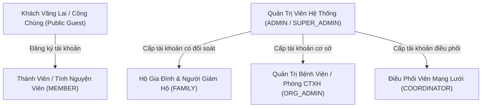

# 🛡️ Ma Trận Phân Quyền & Đặc Tả 6 Vai Trò Hệ Thống (System Roles & Permissions)
### Dự Án: Cổng Ký Ức, Tri Ân & Vinh Danh Các Chiến Binh Nhí (Courageous Little Warriors Hub)
> **Mã môn học:** BIT208V1 - Đồ Án Chuyên Ngành Công Nghệ Thông Tin  
> **Cập nhật:** 19/10/2026 (Phiên bản v2.0 - Chuẩn hóa RBAC đa chiều & Danh tính đa thành tố)

---

## 📌 Mục Lục
1. [Tổng Quan 6 Vai Trò Trong Hệ Thống](#1-tổng-quan-6-vai-trò-trong-hệ-thống)
2. [Cấu Trúc Danh Tính Đa Thành Tố Theo Từng Vai Trò](#2-cấu-trúc-danh-tính-đa-thành-tố-theo-từng-vai-trò)
3. [Ma Trận Phân Quyền Truy Cập Giao Diện (Frontend SSR Web Routes)](#3-ma-trận-phân-quyền-truy-cập-giao-diện-frontend-ssr-web-routes)
4. [Ma Trận Phân Quyền API Backend (REST API RBAC Matrix)](#4-ma-trận-phân-quyền-api-backend-rest-api-rbac-matrix)
5. [Cơ Chế Bảo Vệ Dữ Liệu & Khung Pháp Lý Tích Hợp](#5-cơ-chế-bảo-vệ-dữ-liệu--khung-pháp-lý-tích-hợp)

---

## 1. Tổng Quan 6 Vai Trò Trong Hệ Thống

Hệ thống được thiết kế theo mô hình kiểm soát truy cập dựa trên vai trò (**Role-Based Access Control - RBAC**) với 6 nhóm chủ thể:

### Chi tiết định nghĩa từng vai trò:
1. **`SUPER_ADMIN` / `ADMIN` (Quản Trị Viên Hệ Thống):**
   * Quyền hạn tối cao trên toàn hệ thống.
   * Giám sát Bảng điều hành (*Admin Dashboard*) đa chỉ số.
   * Quản trị người dùng tập trung: Tạo tài khoản cho bất kỳ vai trò nào, liên kết cơ sở y tế/bệnh nhi, khóa/mở khóa tài khoản, reset mật khẩu khẩn cấp.
   * Quản lý nhật ký kiểm toán (*Audit Logs*) và xử lý sự cố.
2. **`COORDINATOR` (Điều Phối Viên Mạng Lưới & Tình Nguyện):**
   * Kết nối giữa Bệnh viện, Nhà tài trợ và Gia đình bệnh nhi.
   * Thực hiện **tiền kiểm duyệt 100% nội dung** (lời chúc chữ và tin nhắn thoại thu âm Web Audio) theo Nghị định 147/2024/NĐ-CP trước khi công khai.
   * Hỗ trợ gia đình nộp hồ sơ bệnh án và cấp tài khoản Hộ gia đình đóng (*Provision Family Account*).
3. **`ORG_ADMIN` (Quản Trị Bệnh Viện / Cán Bộ Phòng Công Tác Xã Hội):**
   * Đại diện pháp lý cho các cơ sở y tế (Bệnh viện Nhi TW, Bệnh viện K, Quỹ Nụ Cười Em...).
   * Quản lý hồ sơ bệnh nhi đang điều trị tại cơ sở, cập nhật tiến độ bệnh án và mã bệnh nhân.
   * Đối soát dòng tiền viện phí Zero-touch gửi về STK bệnh viện theo Nghị định 93/2021/NĐ-CP.
   * Quản lý đội ngũ y bác sĩ, cán bộ điều phối trực thuộc khoa phòng của bệnh viện.
4. **`FAMILY` (Hộ Gia Đình & Người Giám Hộ Hợp Pháp Của Bệnh Nhi):**
   * Tài khoản được cấp riêng cho cha mẹ ruột/người giám hộ hợp pháp sau khi đối soát CCCD và Giấy khai sinh.
   * Quản lý **Kho Kỷ Niệm Của Con (Memorial Media Vault)**: Đăng tải ảnh kỷ niệm, bản vẽ của bé, nhúng video YouTube.
   * **Thu âm lời ru & tin nhắn thoại yêu thương (Web Audio Recorder)** lưu trữ mãi mãi bên trang tưởng niệm của con.
   * Đăng ký và quản lý các điều ước của con trên Cây Điều Ước trực tuyến.
   * Thực thi **Quyền Rút Hồ Sơ Khẩn Cấp (Emergency Unpublish - Quyền Được Quên)** theo Điều 33 Luật Trẻ em 2016.
5. **`MEMBER` (Thành Viên / Nhà Hảo Tâm Đã Đăng Ký):**
   * Người dùng đăng ký tự do để theo dõi các chiến binh nhí, nhận trao quà điều ước và lưu trữ lịch sử ủng hộ viện phí.
6. **`PUBLIC GUEST` (Khách Vãng Lai / Công Chúng Ẩn Danh):**
   * Khách truy cập không cần đăng nhập.
   * Xem danh sách chiến binh nhí, thắp nến hy vọng tương tác, xem Bức Tường Vinh Danh toàn quốc.
   * Tra cứu tính hợp lệ của Chứng Nhận Số qua mã QR.
   * Trải nghiệm Cổng Ngân Hàng Mô Phỏng Sandbox 1-Click chuyển viện phí.

---

## 2. Cấu Trúc Danh Tính Đa Thành Tố Theo Từng Vai Trò

Nhằm chấm dứt tình trạng nhồi nhét hỗn tạp học hàm, chức vụ, quan hệ gia đình vào cột họ tên, hệ thống đã phân rã thành các trường độc lập trong bảng `users`:

| Thuộc tính (Column) | Kiểu dữ liệu | Vai trò áp dụng chính | Ví dụ thực tế |
| :--- | :--- | :--- | :--- |
| `last_name` | `VARCHAR(50)` | Toàn bộ 6 vai trò (Bắt buộc) | `Nguyễn`, `Trần`, `Lê` |
| `middle_name` | `VARCHAR(50)` | Toàn bộ 6 vai trò (Tùy chọn) | `Thị`, `Văn`, `Minh` |
| `first_name` | `VARCHAR(50)` | Toàn bộ 6 vai trò (Bắt buộc) | `Mai`, `Hải`, `Trị` |
| `gender` | `VARCHAR(20)` | Toàn bộ 6 vai trò (`MALE`, `FEMALE`, `OTHER`, `UNSPECIFIED`) | `MALE` $\rightarrow$ Ông / Mr.; `FEMALE` $\rightarrow$ Bà / Mrs. |
| `title_prefix` | `VARCHAR(50)` | `ORG_ADMIN`, `COORDINATOR`, `ADMIN` (Học hàm/học vị) | `BS.`, `ThS.BS.`, `TS.`, `PGS.TS.`, `CN.` |
| `job_title` | `VARCHAR(100)` | `ORG_ADMIN`, `COORDINATOR`, `ADMIN` (Chức vụ chuyên môn) | `Trưởng Khoa Ung Bướu`, `Chuyên viên CTXH` |
| `department` | `VARCHAR(150)` | `ORG_ADMIN` (Khoa phòng bệnh viện) | `Khoa Huyết học Ung bướu`, `Phòng CTXH` |
| `family_relation` | `VARCHAR(50)` | `FAMILY` (Mối quan hệ với bé) | `Bố`, `Mẹ`, `Ông nội`, `Bà ngoại`, `Người giám hộ` |
| `display_mode` | `VARCHAR(30)` | Toàn bộ 6 vai trò (Tùy chọn hiển thị) | `FULL_NAME`, `FIRST_ONLY`, `LAST_FIRST`, `INITIALS`, `ANONYMOUS` |

### Quy tắc sinh tên hiển thị chuẩn hóa (`formatDisplayName`):
- **Đối với `FAMILY`:** `[Họ tên] ([Quan hệ với bé])` $\rightarrow$ Ví dụ: `KTS. Lê Văn Hải (Bố bé Mai Chi)`.
- **Đối với `ORG_ADMIN`:** `[Học hàm] [Họ tên] ([Chức vụ])` $\rightarrow$ Ví dụ: `ThS. Nguyễn Thị Mai (Quản Trị Viên Đơn Vị Y Tế)`.
- **Đối với `COORDINATOR`:** `[Học hàm] [Họ tên] ([Chức vụ])` $\rightarrow$ Ví dụ: `CN. Trần Thị Thu Hà (Điều Phối Viên Mạng Lưới)`.
- **Đối với `ADMIN`:** `[Họ tên] ([Chức vụ])` $\rightarrow$ Ví dụ: `Nguyễn Văn Trị (Quản Trị Viên Vận Hành)`.

---

## 3. Ma Trận Phân Quyền Truy Cập Giao Diện (Frontend SSR Web Routes)

| Đường dẫn (Route) | Chức năng giao diện | `GUEST` | `MEMBER` | `FAMILY` | `ORG_ADMIN` | `COORDINATOR` | `ADMIN` |
| :--- | :--- | :---: | :---: | :---: | :---: | :---: | :---: |
| `/` | Trang chủ kèm Bản Đồ Hy Vọng & Thẻ Sức Khỏe 3-Tier | ✅ | ✅ | ✅ | ✅ | ✅ | ✅ |
| `/warriors` | Danh mục Chiến Binh Nhí (Bộ lọc & Tìm kiếm FTS) | ✅ | ✅ | ✅ | ✅ | ✅ | ✅ |
| `/warriors/:slug` | Chi tiết hồ sơ bé, Kho kỷ niệm, Thắp nến, Gửi lời chúc | ✅ | ✅ | ✅ | ✅ | ✅ | ✅ |
| `/warriors/new` | Tạo hồ sơ chiến binh nhí mới | ❌ | ❌ | ❌ | ✅ | ✅ | ✅ |
| `/family/portal` | Cổng Gia Đình (Kho ảnh/video, Thu âm lời ru, Điều ước) | ❌ | ❌ | ✅ *(Bé của mình)* | ❌ | ❌ | ✅ |
| `/tributes/moderation` | Hàng đợi tiền kiểm lời chúc & Thẩm định âm thanh | ❌ | ❌ | ✅ *(Bé của mình)* | ❌ | ✅ | ✅ |
| `/organizations/portal` | Cổng Bệnh Viện (Bệnh nhi viện, Đối soát, Bác sĩ viện) | ❌ | ❌ | ❌ | ✅ *(Viện mình)* | ❌ | ✅ |
| `/admin/dashboard` | Bảng điều hành đa chiều KPI & Giám sát hệ thống | ❌ | ❌ | ❌ | ❌ | ❌ | ✅ |
| `/admin/users` | Quản trị người dùng, Cấp phát tài khoản, Khóa/Reset | ❌ | ❌ | ❌ | ❌ | ❌ | ✅ |
| `/wishes` | Cây Điều Ước Trực Tuyến Toàn Quốc | ✅ | ✅ | ✅ | ✅ | ✅ | ✅ |
| `/wall-of-honor` | Bức Tường Vinh Danh & Tri Ân Toàn Quốc | ✅ | ✅ | ✅ | ✅ | ✅ | ✅ |
| `/verify/cert/:token` | Tra cứu công khai Chứng Nhận Tri Ân Số qua QR | ✅ | ✅ | ✅ | ✅ | ✅ | ✅ |
| `/auth/login` & `/register` | Đăng nhập và Đăng ký thành viên | ✅ | ❌ | ❌ | ❌ | ❌ | ❌ |

---

## 4. Ma Trận Phân Quyền API Backend (REST API RBAC Matrix)

| Endpoint Backend API | Phương thức | `GUEST` | `MEMBER` | `FAMILY` | `ORG_ADMIN` | `COORDINATOR` | `ADMIN` |
| :--- | :---: | :---: | :---: | :---: | :---: | :---: | :---: |
| `/api/v1/auth/login` | `POST` | ✅ | ✅ | ✅ | ✅ | ✅ | ✅ |
| `/api/v1/auth/register` | `POST` | ✅ | ❌ | ❌ | ❌ | ❌ | ❌ |
| `/api/v1/auth/me` | `GET` | ❌ | ✅ | ✅ | ✅ | ✅ | ✅ |
| `/api/v1/auth/profile` | `PATCH` | ❌ | ✅ | ✅ | ✅ | ✅ | ✅ |
| `/api/v1/auth/provision-family` | `POST` | ❌ | ❌ | ❌ | ❌ | ✅ | ✅ |
| `/api/v1/admin/dashboard/metrics` | `GET` | ❌ | ❌ | ❌ | ❌ | ❌ | ✅ |
| `/api/v1/admin/users` | `GET`, `POST` | ❌ | ❌ | ❌ | ❌ | ❌ | ✅ |
| `/api/v1/admin/users/:id/status` | `PATCH` | ❌ | ❌ | ❌ | ❌ | ❌ | ✅ |
| `/api/v1/admin/users/:id/reset-password` | `POST` | ❌ | ❌ | ❌ | ❌ | ❌ | ✅ |
| `/api/v1/warriors` | `GET` | ✅ | ✅ | ✅ | ✅ | ✅ | ✅ |
| `/api/v1/warriors/:slugOrId` | `GET` | ✅ | ✅ | ✅ | ✅ | ✅ | ✅ |
| `/api/v1/warriors` | `POST` | ❌ | ❌ | ❌ | ✅ | ✅ | ✅ |
| `/api/v1/warriors/:id` | `PATCH` | ❌ | ❌ | ✅ *(Sở hữu)* | ❌ | ❌ | ✅ |
| `/api/v1/warriors/:id/unpublish` | `PATCH` | ❌ | ❌ | ✅ *(Sở hữu)* | ❌ | ❌ | ✅ |
| `/api/v1/warriors/:id/gallery` | `POST`, `DELETE` | ❌ | ❌ | ✅ *(Sở hữu)* | ❌ | ✅ | ✅ |
| `/api/v1/tributes/:id/candle` | `POST` | ✅ | ✅ | ✅ | ✅ | ✅ | ✅ |
| `/api/v1/tributes/:id/tributes` | `POST` | ✅ | ✅ | ✅ | ✅ | ✅ | ✅ |
| `/api/v1/tributes/pending` | `GET` | ❌ | ❌ | ✅ *(Bé của mình)* | ❌ | ✅ | ✅ |
| `/api/v1/tributes/:id/approve` | `PATCH` | ❌ | ❌ | ✅ *(Bé của mình)* | ❌ | ✅ | ✅ |
| `/api/v1/tributes/:id/reject` | `PATCH` | ❌ | ❌ | ✅ *(Bé của mình)* | ❌ | ✅ | ✅ |
| `/api/v1/wishes` | `GET` | ✅ | ✅ | ✅ | ✅ | ✅ | ✅ |
| `/api/v1/wishes` | `POST` | ❌ | ❌ | ✅ *(Sở hữu)* | ❌ | ✅ | ✅ |
| `/api/v1/wishes/:id/sponsor` | `POST` | ✅ | ✅ | ✅ | ✅ | ✅ | ✅ |
| `/api/v1/wishes/:id/fulfill` | `PATCH` | ❌ | ❌ | ✅ *(Sở hữu)* | ❌ | ✅ | ✅ |
| `/api/v1/organizations` | `GET` | ✅ | ✅ | ✅ | ✅ | ✅ | ✅ |
| `/api/v1/organizations/portal/stats` | `GET` | ❌ | ❌ | ❌ | ✅ *(Thuộc viện)* | ❌ | ✅ |
| `/api/v1/organizations/:id` | `PUT` | ❌ | ❌ | ❌ | ✅ *(Thuộc viện)* | ❌ | ✅ |
| `/api/v1/donations/submit-proof` | `POST` | ✅ | ✅ | ✅ | ✅ | ✅ | ✅ |
| `/api/v1/donations/mock-sandbox-pay`| `POST` | ✅ | ✅ | ✅ | ✅ | ✅ | ✅ |
| `/api/v1/donations/wall` | `GET` | ✅ | ✅ | ✅ | ✅ | ✅ | ✅ |
| `/api/v1/donations/pending` | `GET` | ❌ | ❌ | ✅ *(Bé của mình)* | ✅ *(Viện mình)* | ❌ | ✅ |
| `/api/v1/donations/:id/verify` | `PATCH` | ❌ | ❌ | ✅ *(Bé của mình)* | ✅ *(Viện mình)* | ❌ | ✅ |
| `/api/v1/donations/verify/:qrToken` | `GET` | ✅ | ✅ | ✅ | ✅ | ✅ | ✅ |

---

## 5. Cơ Chế Bảo Vệ Dữ Liệu & Khung Pháp Lý Tích Hợp

### 5.1. Chống can thiệp chéo tài khoản (Account Isolation Middleware)
Hệ thống sử dụng middleware chuyên biệt [`ensureFamilyOwnership`](file:///home/binhnguyen/Courageous-Little-Warriors-Memorial-and-Tribute-Hub/backend-api/src/shared/middlewares/ensureFamilyOwnership.js):
- Khi một yêu cầu chỉnh sửa hồ sơ bé, xóa ảnh kỷ vật, hoặc rút hồ sơ khẩn cấp được gửi lên:
- Middleware lập tức truy vấn đối chiếu: `child.family_user_id === req.user.id`.
- Nếu không trùng khớp và không phải `ADMIN`/`SUPER_ADMIN`, hệ thống từ chối ngay lập tức với mã lỗi `403 Forbidden` và tự động ghi vết vi phạm vào bảng `audit_logs`.

### 5.2. Quyền Tối Thượng Rút Hồ Sơ Khẩn Cấp (Điều 33 Luật Trẻ Em 2016)
- Phụ huynh được trang bị quyền thực thi ẩn hồ sơ ngay tức khắc (`Emergency Unpublish`).
- Thao tác này kích hoạt soft-delete: đặt `is_published = FALSE` và `deleted_at = NOW()`.
- Hồ sơ của con ngay lập tức biến mất khỏi tất cả các trang danh sách công khai, kết quả tìm kiếm FTS và trang chủ mà **hoàn toàn không cần chờ đợi phê duyệt từ bất kỳ cấp quản lý nào**.

### 5.3. Tiền kiểm duyệt đa phương tiện (Nghị định 147/2024/NĐ-CP)
- 100% nội dung gửi tới trang tưởng niệm của các con (bao gồm cả chữ viết và tệp ghi âm giọng nói Web Audio) đều mặc định khởi tạo ở trạng thái `status = 'PENDING'`.
- Chỉ khi Điều phối viên (`COORDINATOR`), Quản trị viên (`ADMIN`) hoặc chính Cha mẹ bé (`FAMILY`) bấm nút **"Phê duyệt"** trên giao diện kiểm duyệt thì nội dung mới hiển thị công khai.

### 5.4. Cơ chế dòng tiền Zero-touch (Nghị định 93/2021/NĐ-CP)
- Nền tảng tuyệt đối không giữ tiền hay đóng vai trò trung gian thanh toán.
- Toàn bộ đóng góp được chuyển thẳng 100% qua VietQR Napas247 vào tài khoản ngân hàng của Bệnh viện hoặc cha mẹ ruột đã qua thẩm định y tế.
- Mọi giao dịch được đối soát công khai và cấp Chứng Nhận Số có chữ ký điện tử HMAC-SHA256 nhằm ngăn chặn hoàn toàn nguy cơ làm giả hoặc trục lợi từ thiện.
